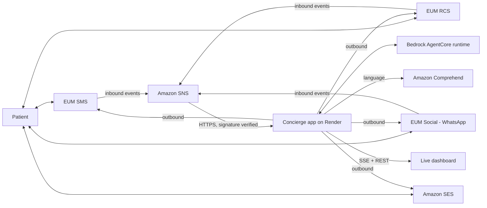

# Omnichannel Concierge

An agentic customer-engagement app built on **AWS Communication Developer Services (CDS)**: one AI agent follows each patient across **SMS, RCS, WhatsApp and email**, picks the best channel for each step, and finishes the task, with a live cyberpunk control-center dashboard. Built for the *AWS CDS Agentic AI Partner Hackathon*.

**Example flow (pharmacy refill):** SMS reminder, patient replies "YES", the agent switches to an **RCS rich card** with pickup slots, the patient taps one, and the confirmation arrives by **email**. A WhatsApp patient asking a question is answered in the same conversation.

**Languages:** English (default), French, Spanish, Portuguese. The dashboard and the agent's patient-facing messages follow the patient's language (Amazon Comprehend in live mode, a keyword heuristic in demo mode). Adding a language is covered below.

## Architecture



| Path | Purpose |
|---|---|
| `server.js` | Express app: dashboard, SSE stream, SNS webhook, admin API |
| `src/engine.js` | Conversation registry, inbound handling, delivery |
| `src/agent.js` | Next-step decision: AgentCore runtime, or local rules as fallback |
| `src/channels.js` | Senders: `SendTextMessage`, `SendRcsMessage`, `SendWhatsAppMessage`, SES `SendEmail` |
| `src/inbound.js` | Maps SNS event payloads to `{ from, channel, text, postback }` |
| `src/i18n.js` | Patient-facing message templates and language detection |
| `public/` | Dashboard (`i18n.js` holds the UI dictionaries) |

## Run locally

```bash
npm install
cp .env.example .env      # optional in demo mode
npm start                 # http://localhost:3000
npm test
```

By default `DEMO_MODE=true`: simulated patients drive the real engine and **no AWS call is made**. Change the language in the top-right selector and the demo restarts in that language.

## Go live on AWS

1. **Messaging:** create an AWS End User Messaging SMS origination identity, an **RCS agent** in the *Active* state, a WhatsApp business account linked through End User Messaging Social, and a verified SES identity.
2. **IAM:** create a user or role with `docs/iam-policy.json` (scope `Resource` down for production) and set `AWS_ACCESS_KEY_ID` / `AWS_SECRET_ACCESS_KEY` / `AWS_REGION`.
3. **Inbound:** enable two-way messaging on your identities with an **SNS topic** as destination, then subscribe `https://<your-app>.onrender.com/webhooks/sns` (HTTPS). The app confirms the subscription and verifies every message signature. Set `SNS_TOPIC_ARN` so only your topic is accepted.
4. **Agent (optional):** deploy an agent on Bedrock AgentCore Runtime and set `AGENTCORE_RUNTIME_ARN`. Contract: the app POSTs `{ language, state, patient, input }` and expects `{ state?, steps: [{ channel, text, card?, subject?, actions?, trace? }] }`. Without it, the built-in rules in `src/agent.js` run.
5. Set `DEMO_MODE=false`, then open a real conversation:

```bash
curl -X POST https://<your-app>.onrender.com/api/refill \
  -H "Authorization: Bearer $ADMIN_TOKEN" -H "Content-Type: application/json" \
  -d '{"name":"Jane Doe","phone":"+15551234567","email":"jane@example.com","lang":"en","preferred":"sms"}'
```

`POST /api/inbound` (same token) simulates a patient reply without a handset.

## Deploy on Render

1. Push this repository to GitHub.
2. In Render: **New > Blueprint**, select the repository. `render.yaml` configures a Node web service with a `/healthz` health check; `ADMIN_TOKEN` is generated for you.
3. Fill in the variables Render asks for (leave them empty for demo mode). The app is live at your `onrender.com` URL.

The free plan sleeps after inactivity, so the first request can take a while. Use a paid instance for the demo video and judging.

## Add a language

1. Add a block in `public/i18n.js` and an entry in `LANGS` (`public/app.js`).
2. Add the templates in `src/i18n.js` (`T`), the code in `SUPPORTED`, and keywords in `STOP`.

## Known limits (read before production)

- State (conversations, counters) is **in memory**: use DynamoDB for persistence and multiple instances.
- `src/inbound.js` is a best-effort mapping of End User Messaging event payloads. **Send a real test message and adjust it** if your event shape differs (especially RCS postbacks and WhatsApp).
- The pharmacy lookup and leaflet answer in `src/agent.js` are stubs. The sample content is for demonstration, not medical advice. Real deployments need clinical review, consent and opt-out handling, and local messaging regulations.
- The dashboard counters are seeded with sample numbers in demo mode.

## Hackathon submission checklist

- [ ] Repository public with this MIT license, or private and shared with `testing@devpost.com` and `aws-cds-partner@amazon.com`
- [ ] Architecture diagram (export the Mermaid chart above as an image)
- [ ] Text description and ~3-minute demo video
- [ ] Deployed URL, or instructions to interact with it
- [ ] Opportunity ID created in AWS Partner Central (ACE) with the campaign code "AWS CDS Agentic AI Hackathon -Sept. 2026."
- [ ] For the WhatsApp prize: a short description of how End User Messaging Social is used

## License

MIT, see `LICENSE`.
